**MICROSOFT 365 COPILOT COWORK \| LAB GUIDE**

# Lab 4: Building Custom Cowork Skills (Read Only)

| EST. DURATION | TASKS | STEPS |
| --- | --- | --- |
| 30 min | 8 | 126 |

## Overview

In this hands-on lab, you will use Copilot Cowork's conversational skill builder to create two reusable custom skills. Rather than filling out forms or writing code, you will start the builder from the Customize page, answer a short series of questions in plain language, and approve the save while Cowork writes the SKILL.md file to your Cowork skills folder in OneDrive. You will plan a skill specification on paper, build a Leadership Update skill and test it against a sample input, build a second Project Status Brief skill, review its quality report and skill details, download the skill file and upload it again, invoke the skill using its trigger phrase, and publish its output to a Microsoft Teams channel with human approval at the write step. Along the way, you will review the skill management options, including Download and Delete.

> **Note:** This is a read-only lab intended to introduce the key concepts and capabilities of building custom skills in Microsoft 365 Copilot Cowork. No hands-on activities are performed in this exercise, in order to manage credit consumption for the workshop. Participants will gain the foundational knowledge needed to understand how custom skills are created, tested, and used.

## Objectives

In this lab, you will perform the following:

- **Task 1:** Design Your Skill on Paper First

- **Task 2:** Start the Skill Builder for the Leadership Update Skill

- **Task 3:** Answer the Skill Builder Questions and Save the Skill

- **Task 4:** Test the Leadership Update Skill

- **Task 5:** Build the Project Status Brief Skill

- **Task 6:** Review, Inspect, and Download the Project Status Brief Skill

- **Task 7:** Upload and Run the Project Status Brief Skill

- **Task 8:** Post the Project Status Brief to a Teams Channel

## Task 1: Design Your Skill on Paper First

### Open Microsoft 365 Copilot Cowork

1.  Open a web browser.

2.  In the address bar, enter the following URL and press **Enter**:

    ```
    https://m365.cloud.microsoft
    ```

3.  Sign in using the provided lab credentials.

4.  After signing in, select the **Cowork** tab at the top of the left navigation pane, between **Chat** and **Code**.

5.  Verify the **Cowork** home page opens successfully.

    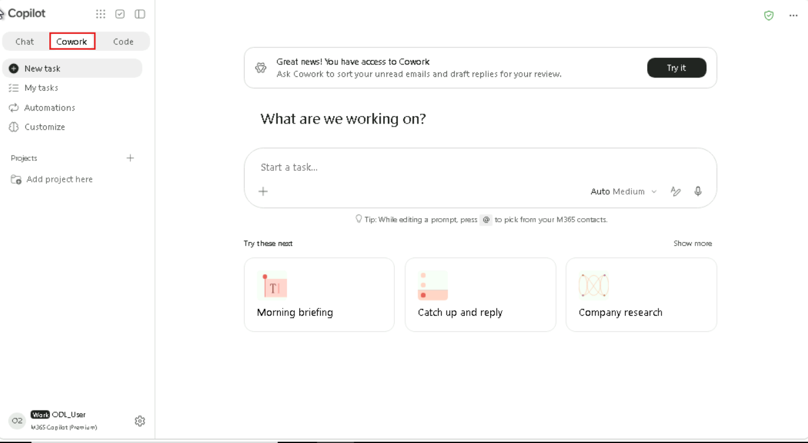

6.  Verify the following components are available:

- **New task**

- **My tasks**

- **Automations**

- **Customize**

7.  Confirm the **Cowork** tab is selected before proceeding to the next task.

### Open Notepad and Capture Planning Requirements

8.  Open the **Start** menu.

9.  Search for **Notepad** and select the application from the search results.

    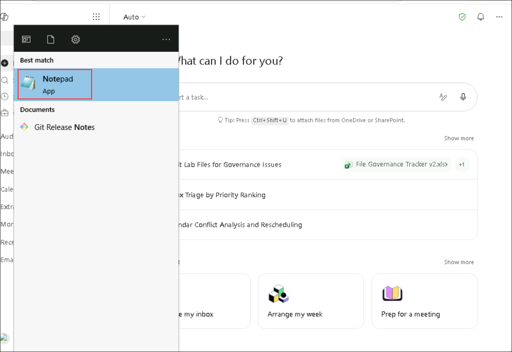

10. Open **Notepad** and resize the window so it is visible alongside the browser window.

11. In Notepad, enter the following planning questions:

    ```
    What should this skill do?

    What does it need to read?

    Does it write or change anything?

    What should the output look like?

    Is there a variable that might change?
    ```

12. Verify all five planning questions have been added to the Notepad document.

    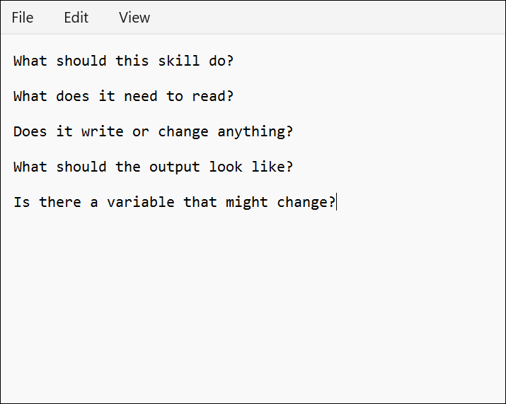

13. Review each question and enter your responses below the corresponding question.

14. Save the notes for reference during the remaining exercises.

    > **Note:** Use the sample answers below as a reference if you are unable to complete the notepad entries independently.

    ```
    What should this skill do?

    Generate concise leadership update messages from project, operational, or business input provided by the user. The skill should create executive-ready updates focused on key accomplishments, risks, decisions, next steps, and overall status.

    What does it need to read?

    User-provided project updates, status notes, milestones, risks, business updates, meeting summaries, or task completion details.

    Does it write or change anything?

    No. The skill only generates communication content and does not modify files, messages, or data sources.

    What should the output look like?

    A professional leadership update with:
    - Executive Summary
    - Key Accomplishments
    - Risks and Issues
    - Next Steps
    - Overall Status

    Is there a variable that might change?

    Yes.
    - Project name
    - Reporting period
    - Audience
    - Business unit
    - Status details
    - Risks and action items
    ```

15. Keep the Notepad window open and accessible while working through the lab.

16. In the existing **Notepad** document, scroll below the planning questions and responses entered in the previous task.

17. Add a new section for the skill specification.

18. Enter the following Skill Specification fields:

    ```
    Skill Name:

    Trigger Phrase:

    Parameters:

    Apps It May Read:

    Apps It May Write:

    Output Format:
    ```

19. Complete each field based on the requirements of the Leadership Update skill.

20. Verify the Skill Specification contains all required information.

    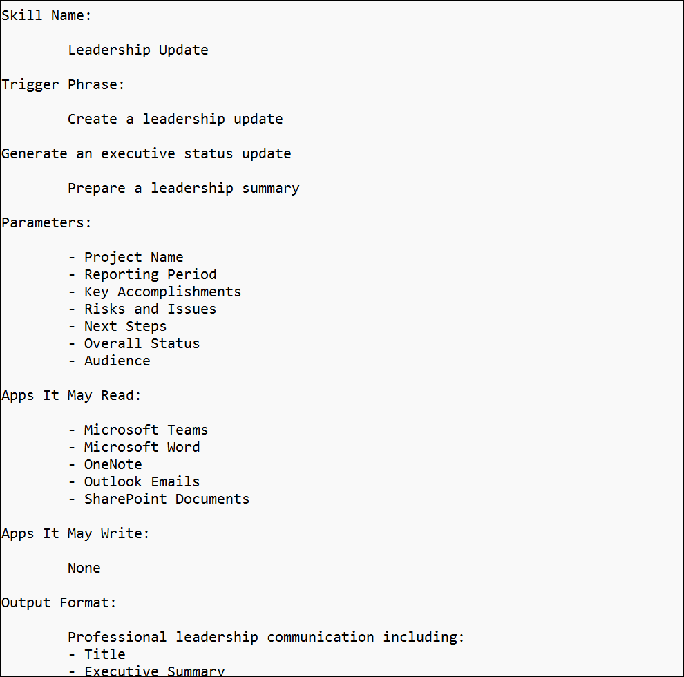

    > **Note:** Use the sample Skill Specification template provided below as a reference if you are unable to complete the notepad entries independently.

    ```
    Skill Name:

    Leadership Update

    Trigger Phrase:

    Create a leadership update

    Generate an executive status update

    Prepare a leadership summary

    Parameters:

    - Project Name
    - Reporting Period
    - Key Accomplishments
    - Risks and Issues
    - Next Steps
    - Overall Status
    - Audience

    Apps It May Read:

    - Microsoft Teams
    - Microsoft Word
    - OneNote
    - Outlook Emails
    - SharePoint Documents

    Apps It May Write:

    None

    Output Format:

    Professional leadership communication including:
    - Title
    - Executive Summary
    - Key Achievements
    - Risks and Mitigations
    - Upcoming Activities
    - Status Indicator (Green/Amber/Red)

    Output should be concise, executive-friendly, and suitable for email, Teams, or leadership review.
    ```

21. Review the Skill Specification and confirm the following details are documented:

- Skill Name

- Trigger Phrase

- Parameters

- Apps It May Read

- Apps It May Write

- Output Format

22. Save the Notepad document.

23. Keep the Skill Specification available for reference during the remaining exercises.

24. Do not paste the Skill Specification into Copilot Cowork unless instructed later in the lab.

## Task 2: Start the Skill Builder for the Leadership Update Skill

In this task, you open the Customize page and start the Copilot Cowork skill builder. Instead of filling out a form, Cowork starts a new task and asks you a short series of questions about the skill you want to create.

1.  On the **Copilot Cowork** home page, select the **+** icon at the left of the **Start a task...** prompt box.

2.  Review the options displayed in the menu: **Add work context**, **Upload images and files**, **Attach cloud files**, and **Customize**.

3.  Select **Customize** (Manage skills & plugins).

    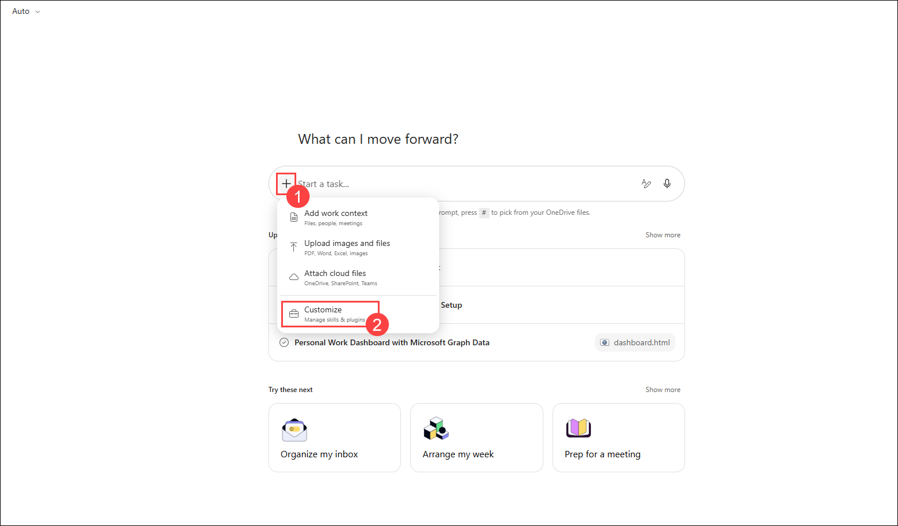

### Create a New Skill

4.  Verify the **Customize** page opens. You can also open this page by selecting **Customize** in the left navigation pane.

5.  Review the Customize page and confirm the following sections are available:

- **Search for a Cowork capability** search box

- **Added**, which lists the skills and plugins already available to you, with a **Manage all** link

- **Discover**, which lists plugins you can add under **Get started**

6.  Select **Add** in the upper-right corner of the page.

7.  Review the options in the dropdown menu: **Create skill with Cowork** and **Upload**.

8.  Select **Create skill with Cowork**.

    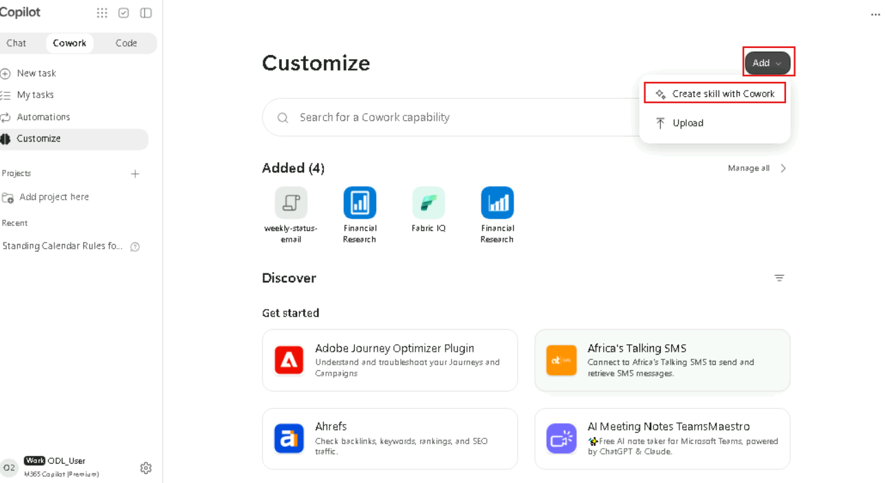

9.  Verify that Cowork starts a new task and sends the following request for you: "I want to create a new personal skill. Guide me through defining the skill name, description, category, and instructions. Help me write a SKILL.md file and save it to my OneDrive skills folder."

10. Wait while Cowork shows **Getting things in order**.

    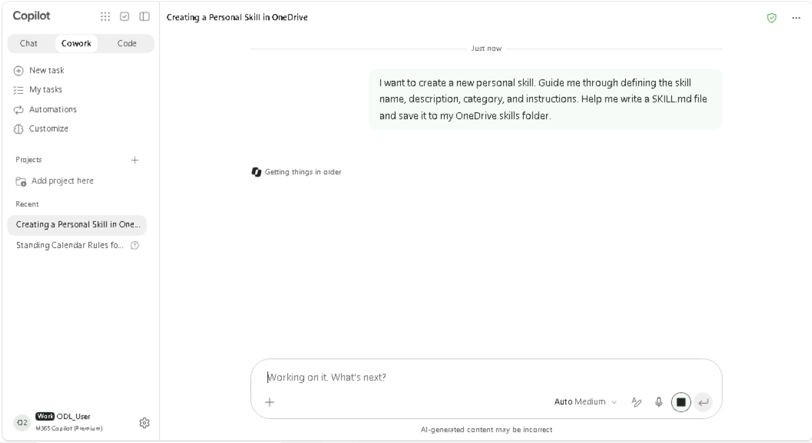

11. Confirm a new skill creation task, such as **Creating a Personal Skill in OneDrive**, appears under **Recent** in the left navigation pane.

    > **Note:** The task title is generated automatically, so it may differ slightly (for example, **Creating a Personal Skill Guide**).

    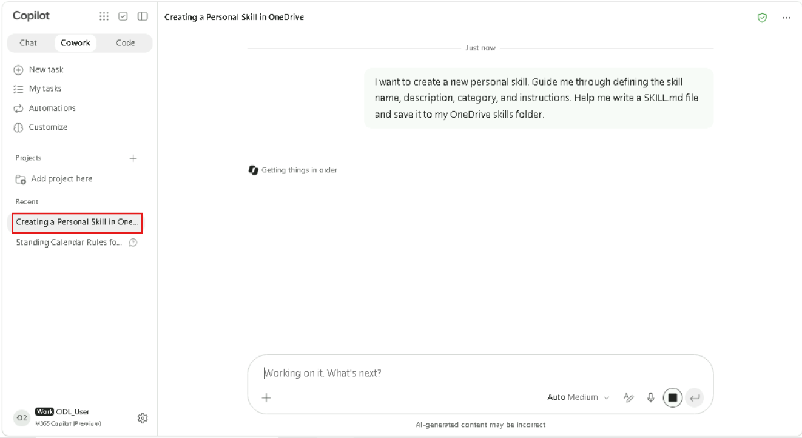

12. Wait for the thought process to complete and the first skill builder question to appear above the prompt box.

13. Review the question card. The counter in the upper-right corner (for example, **1 of 5**) shows how many questions there are. Use the **\<** and **\>** arrows to move between questions, **Skip** to leave a question blank, and **X** to close the card.

    > **Note:** The skill builder asks four or five questions, and their wording and order can change between sessions. Read each question and enter the answer that matches what it asks for.

    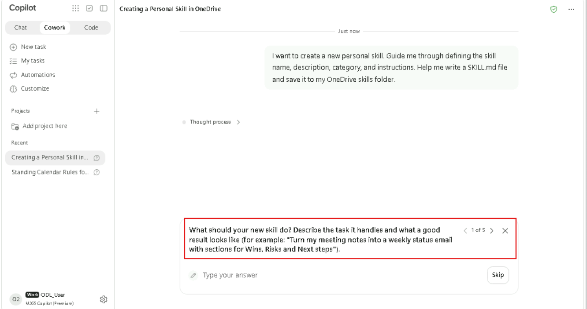

## Task 3: Answer the Skill Builder Questions and Save the Skill

In this task, you answer the skill builder questions using the Leadership Update specification from Task 1. Cowork then writes the SKILL.md file, checks its quality, and asks for your approval before saving it to your Cowork skills folder in OneDrive.

1.  For the first question, which asks what the skill should help you do, enter the following answer:

    ```
    Turn project, operational, or business updates that I provide into a concise leadership / executive update. Read my notes, pull out the overall progress, key accomplishments, risks and blockers, and what I need from leadership. The result should be a short, professional message with four sections: Headline, Progress, Risks and Blockers, and Asks / Next Steps, ready to send to senior leadership.
    ```

2.  Select **Next** or press **Enter**.

    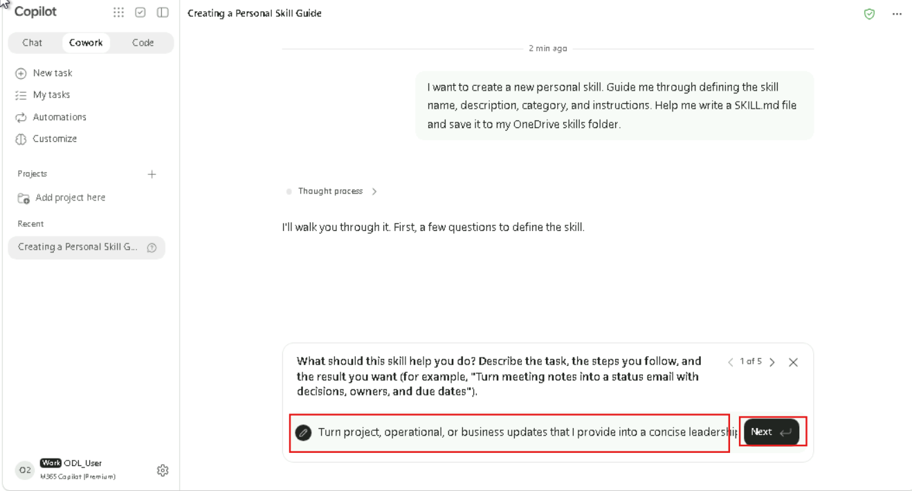

3.  For the question that asks what to call the skill, enter the following name:

    ```
    leadership-update
    ```

4.  Select **Next**.

    > **Note:** Skill names use short lowercase words separated by hyphens. If you leave the name blank, Cowork suggests one for you.

    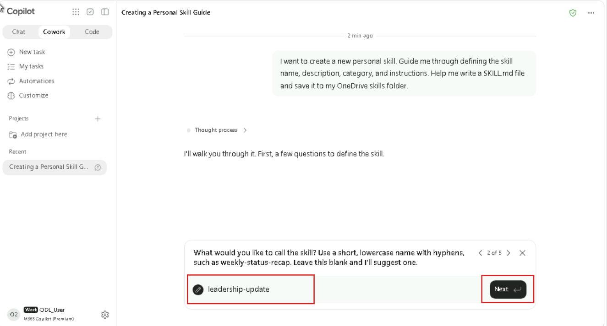

5.  For the question **Which category fits it best?**, select **Communication** (Emails, Teams messages, announcements, replies).

6.  Select **Next**.

    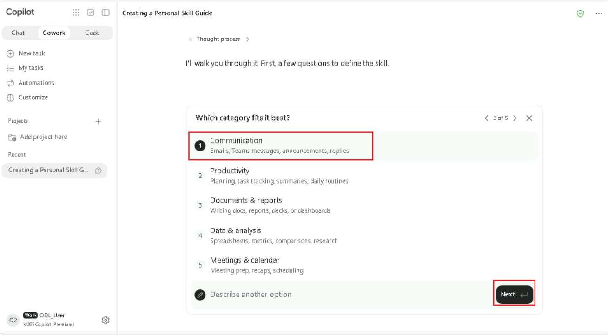

7.  For the question that asks which phrases you would type to use the skill, enter the following trigger phrases:

    ```
    Create a leadership update, Generate an executive status update, Prepare a leadership summary
    ```

8.  Select **Next**.

    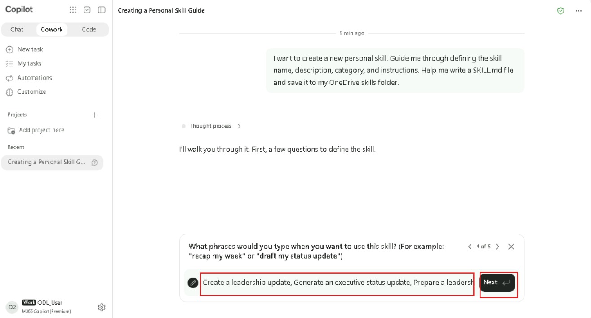

9.  For the question that asks about rules the skill should always follow, enter the following rules:

    ```
    Tone: professional and concise, suitable for senior leadership. Keep the update under 200 words. Always use four sections in this order: Headline (one sentence on overall status, including Green / Amber / Red), Progress (2–4 bullets), Risks and Blockers (bullets with impact if not addressed), and Asks / Next Steps (specific asks of leadership and upcoming actions). Use only the information I provide or content from Teams, Outlook, Word, OneNote, or SharePoint; never invent figures, dates, or names. Never send, post, or change anything; only draft the update text.
    ```

10. Select **Submit**.

    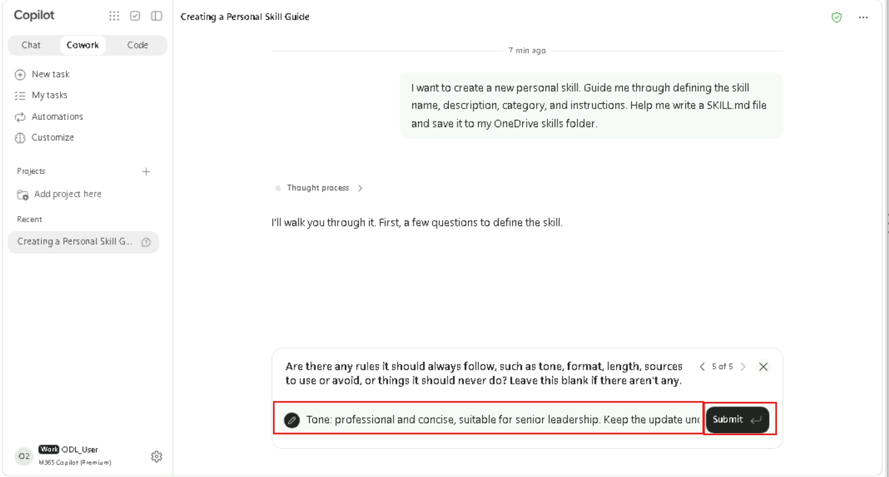

11. Monitor the **Working on 1 background task** message while Cowork creates the **leadership-update** skill. The **Workspace** pane opens on the right and shows **skill-quality-report.html** under **Output** and **Skill Management** under **Plugins**.

12. When the **Copy file** approval card appears, review the following details:

- **To:** Your Cowork folder / skills / leadership-update

- **Overwrite:** Yes

- **Recursive:** Yes

- **Source:** working/leadership-update

13. Select **Approve** to save the skill to your Cowork skills folder.

    > **Note:** Cowork asks for your approval before it writes files to your OneDrive. If you select **Cancel**, the skill isn't saved.

    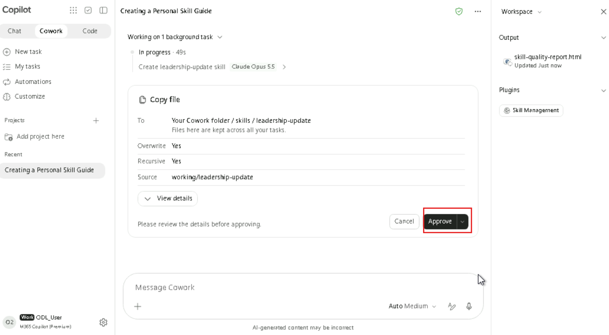

14. Wait for Cowork to finish, and then review the completion summary. In the **Changes I made** section, note any adjustments Cowork made, such as limiting the skill so it doesn't overlap with a similar skill you already have.

15. Verify the following cards appear at the end of the response:

- **leadership-update** (Skill)

- **skill-quality-report** (HTML file)

    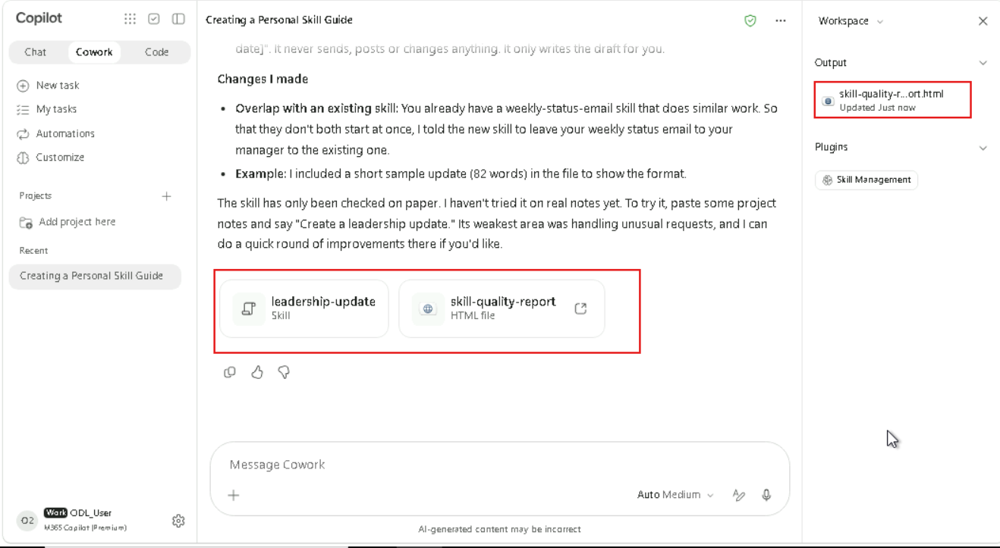

16. Select the **skill-quality-report.html** under **Output** in the Workspace pane.

    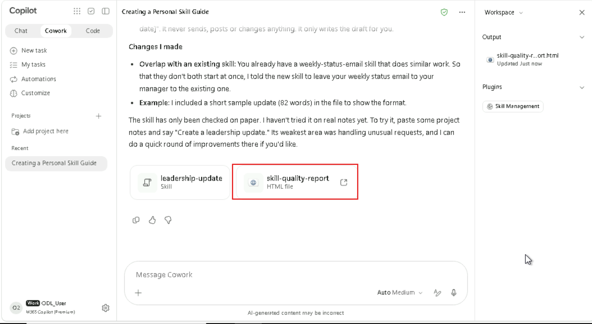

17. Review the quality report and verify it shows the following:

- The skill name **LEADERSHIP-UPDATE** and the status **This skill is ready to share**

- An overall health score out of 100, with **Meets the bar to publish**

- **Risk** and **Grounding** indicators

- A **What's already working** checklist

    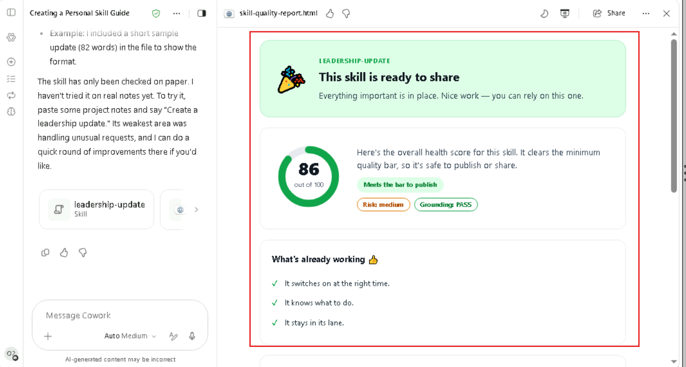

18. Close the report preview by selecting **X** in the upper-right corner.

## Task 4: Test the Leadership Update Skill

A skill is only useful if it runs when you call it. In this task, you test the skill with a sample input and confirm that Cowork used it.

1.  In the left navigation pane, select **New task**.

2.  Verify the Copilot Cowork home page opens with the **Start a task...** prompt box and the **Try these next** suggestions.

3.  In the prompt box, enter the following prompt:

    ```
    Use leadership-update
    Summarize the following:
    Over the past week, several key initiatives have made progress. Most planned activities are on schedule, although a few tasks are taking longer than expected due to resource constraints. Team collaboration has improved, and stakeholder engagement remains positive. Some risks have been identified that may impact upcoming deadlines if not addressed. Additional support may be needed to maintain momentum.
    ```

4.  Review the prompt, and then select the **Send** (arrow) button or press **Enter**.

    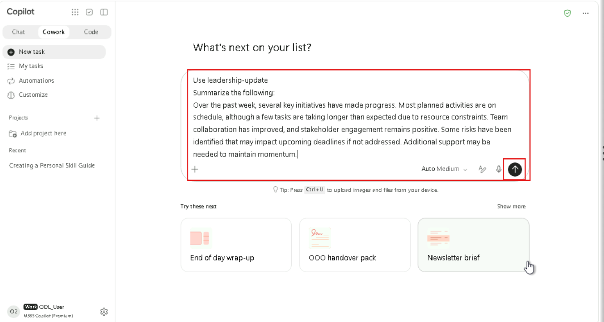

5.  Wait for Cowork to process the request. Verify the activity log shows **Reviewed custom skill Leadership update**.

6.  Verify **leadership-update** appears under **Plugins** in the **Workspace** pane. This confirms that the custom skill was used.

7.  Review the generated update and verify it's organized into the following sections:

- **Headline**

- **Progress**

- **Risks and Blockers**

- **Asks / Next Steps**

    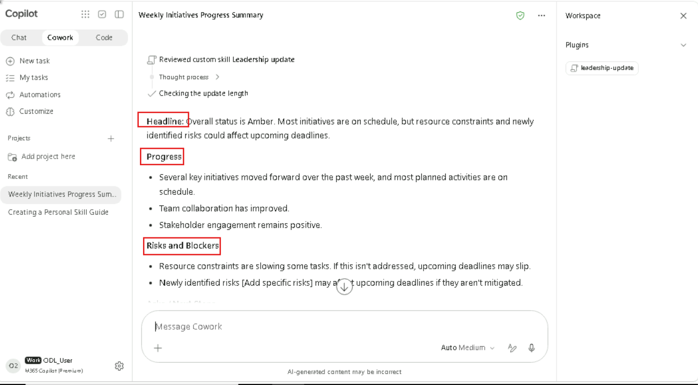

8.  Scroll down to review the **Asks / Next Steps** section, the word count, and any placeholders, such as **\[Add date\]** or **\[Add owner\]**, that the skill adds where details were missing.

9.  Review the explanation of the status rating (for example, **Amber**) at the end of the response.

    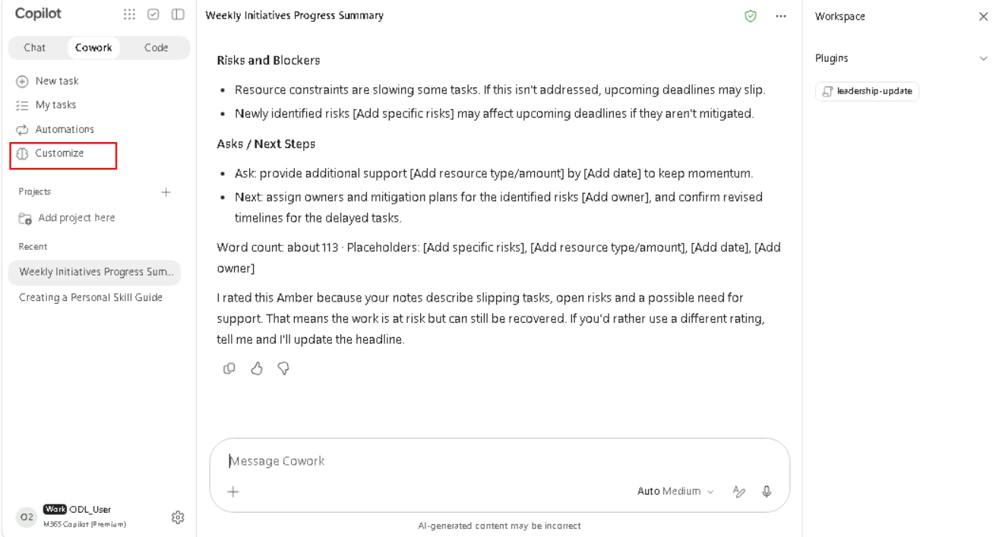

10. In the left navigation pane, select **Customize**.

11. Verify the new **leadership-update** skill is listed under **Added** and is available for future tasks.

    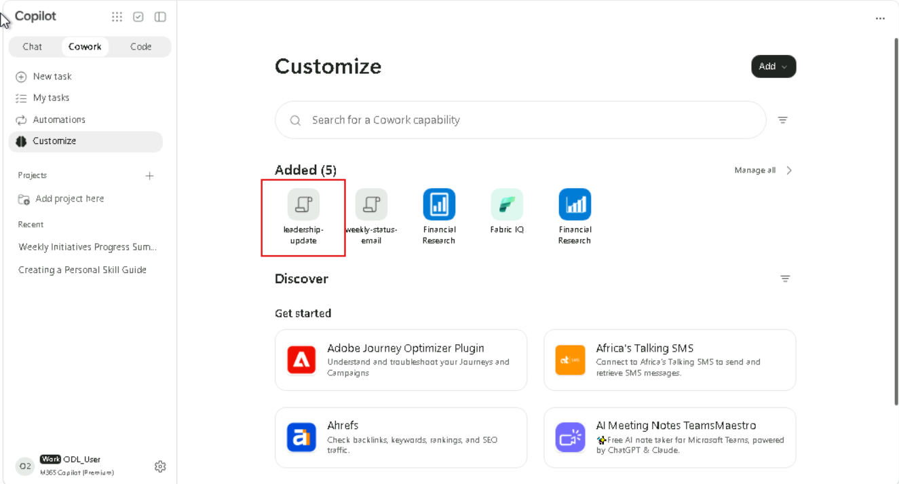

## Task 5: Build the Project Status Brief Skill

Now apply the same conversational pattern to a Project Orion operations scenario. This time, the skill builder may ask four questions instead of five, and its first question asks for the task, the trigger phrases, and the expected output together.

1.  In the left navigation pane, select **Customize**.

2.  Verify the **leadership-update** skill is listed under **Added**.

3.  Select **Add** in the upper-right corner, and then select **Create skill with Cowork**.

    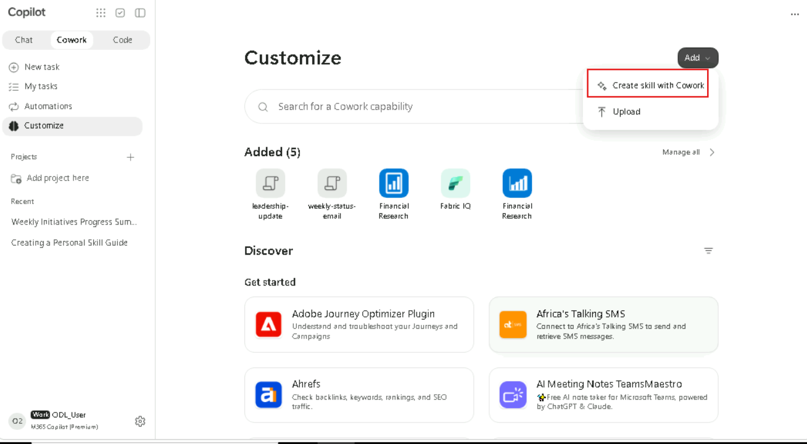

4.  Wait for the new skill creation task to start and the first question to appear.

5.  For the first question, which asks what the skill should do, when it should trigger, and what it should produce, enter the following answer:

    ```
    Generate a concise project status brief from project updates, meeting notes, task progress, risks, and milestone details that I provide or that are in Teams, Outlook, Word, OneNote, or SharePoint. Trigger when I ask to "create a project status brief", "generate a project update", "summarize project progress", or "give me the project status brief". Produce a professional brief with these sections: Project Overview, Key Accomplishments, Current Status, Risks and Blockers, Upcoming Milestones, and Next Steps.
    ```

6.  Select **Next**.

    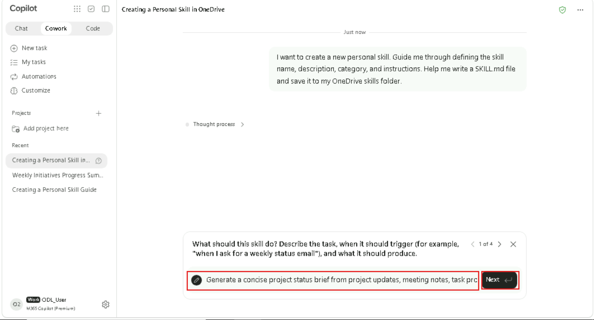

7.  For the question **Which category fits the skill best?**, select **Documents & reports** (Word, Excel, PowerPoint, dashboards, templates).

8.  Select **Next**.

    > **Note:** The category options can differ from the ones you saw when you built the first skill.

    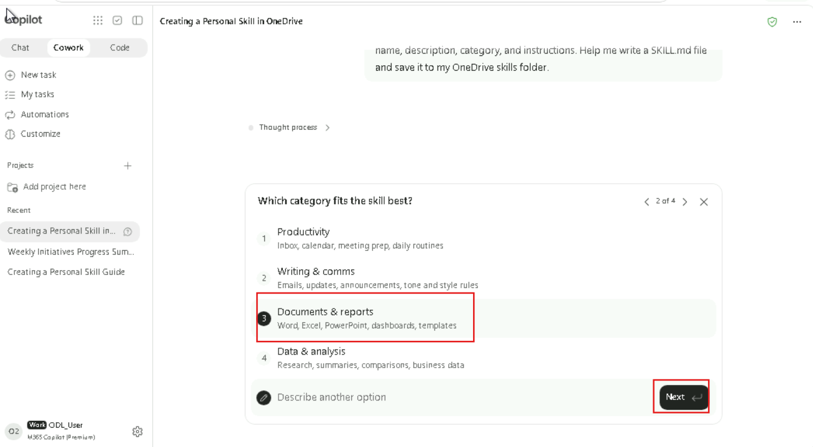

9.  For the question that asks for a name, enter the following name:

    ```
    project-status-brief
    ```

10. Select **Next**.

    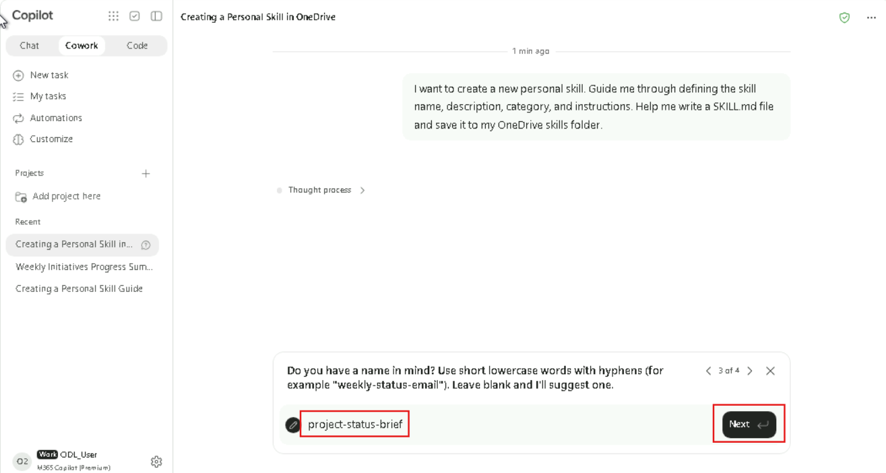

11. For the question that asks about rules the skill must follow, enter the following rules:

    ```
    Tone: professional and concise. Keep the brief to one page. Always use the six sections in this order: Project Overview, Key Accomplishments, Current Status, Risks and Blockers, Upcoming Milestones, Next Steps. Audience: project stakeholders and leadership. Use only the information I provide or content from Teams, Outlook, Word, OneNote, or SharePoint; never invent figures, dates, or names. Never send, post, or change anything on its own; only draft the brief and wait for my instruction before sharing it anywhere.
    ```

12. Select **Submit**.

    

13. Wait for Cowork to create the skill. When the **Copy file** approval card appears, verify the following details:

- **To:** Your Cowork folder / skills / project-status-brief

- **Source:** working/project-status-brief

14. Select **Approve**.

    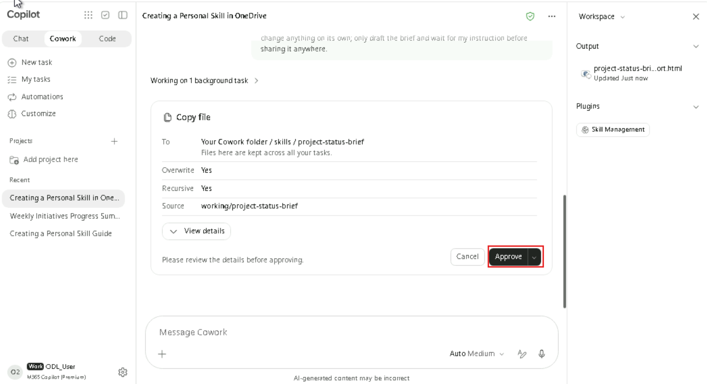

15. Review the completion summary and verify that Cowork created the **project-status-brief** skill and saved it to OneDrive at **Documents/Cowork/skills/project-status-brief/SKILL.md**.

16. Review the **What I put in the skill** section, including the name, the description, and the trigger phrases.

    > **Note:** If Cowork doesn't accept the category you selected, it uses the closest allowed category (for example, **writing**) and tells you in the summary. You can ask Cowork to change the category if needed.

    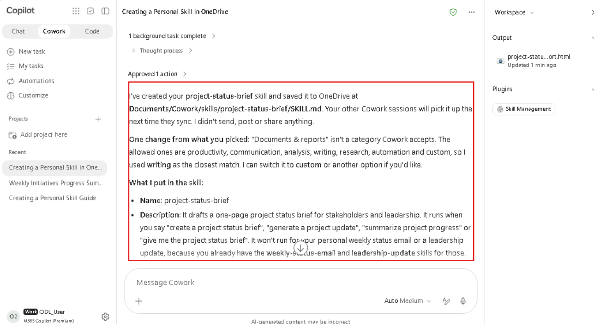

17. Scroll down and review the **Format**, **Your rules**, and **Checks** sections. Verify the skill passed the format check and received a quality score.

18. Verify the **project-status-brief-quality-report** card (HTML file) appears at the end of the response.

    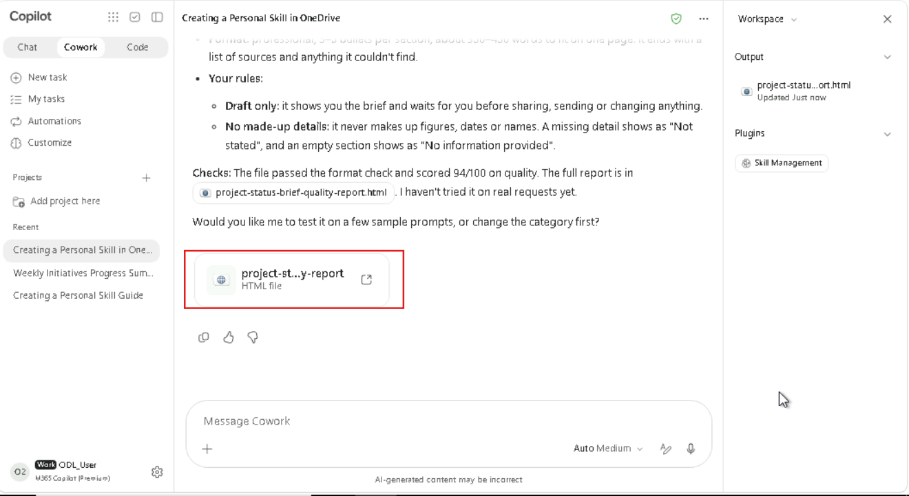

## Task 6: Review, Inspect, and Download the Project Status Brief Skill

In this task, you review the quality report, open the skill details page, review the skill's instructions and management options, and download the skill file for the upload exercise in Task 7.

1.  Select the **project-status-brief-quality-report** card to open the quality report.

2.  Review the report and verify it shows the following:

- The skill name **PROJECT-STATUS-BRIEF** and the status **This skill is ready to share**

- An overall health score out of 100, with **Meets the bar to publish**

- **Risk** and **Grounding** indicators

- A **What's already working** checklist

    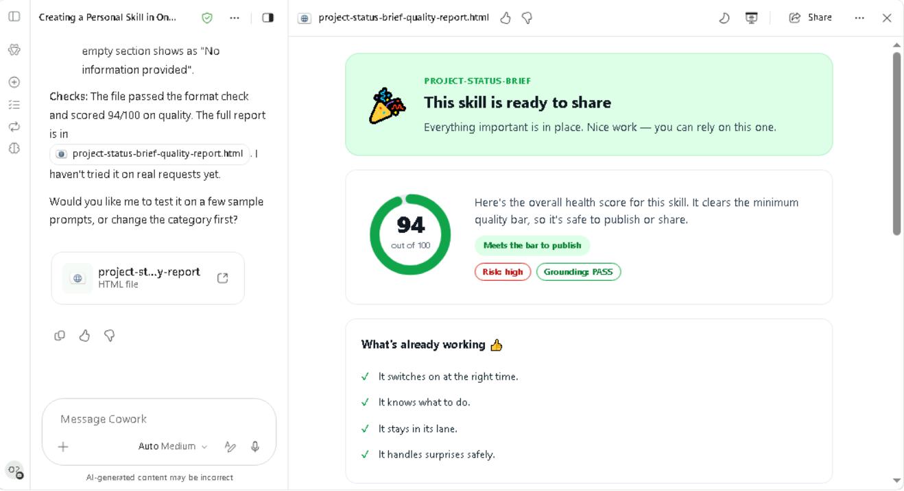

3.  Close the report preview.

4.  In the left navigation pane, select **Customize**.

    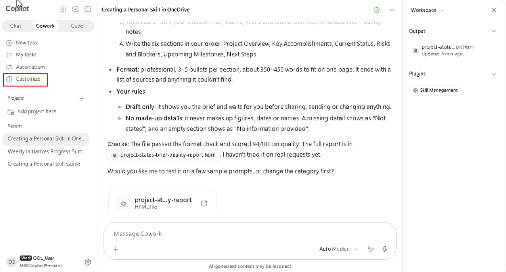

5.  Verify the **project-status-brief** skill is listed under **Added**, next to **leadership-update**.

6.  Select **project-status-brief** to open the skill details page.

    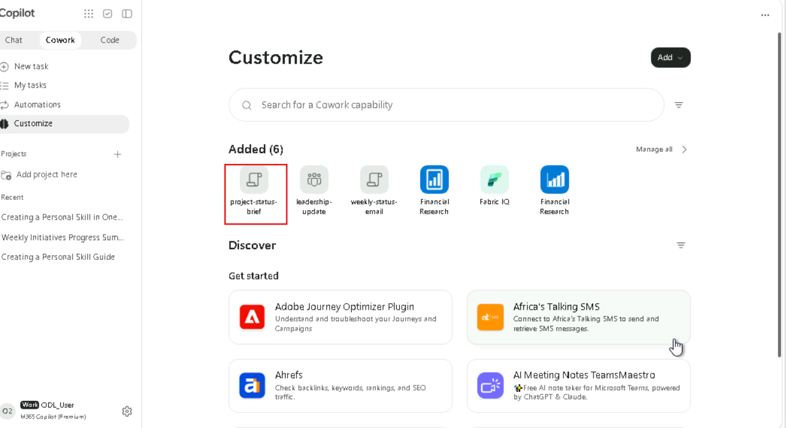

7.  Review the skill details page and verify it includes the following:

- The skill name and **Created by you**

- The skill description

- **Instructions**, with **Overview**, **When to Use**, and **When NOT to Use** sections

8.  Review the **When NOT to Use** section and verify it sends other requests to your other skills, such as **weekly-status-email** and **leadership-update**.

9.  Note the icons beside **Instructions**, which you can use to edit the skill's instructions or open them in a separate view.

    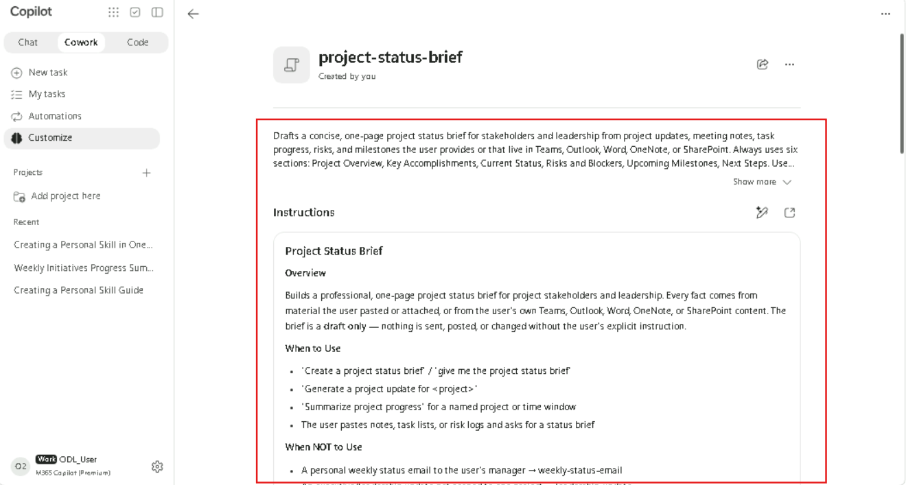

10. Select the **ellipsis (...)** in the upper-right corner of the skill details page.

11. Verify the following actions are available:

- **Download**

- **Delete**

    > **Note: Delete** permanently removes the skill. Use **Download** to save a copy of the skill file before you change or remove a skill.

    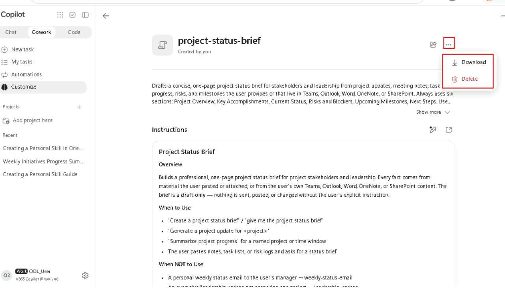

12. Select **Download**.

    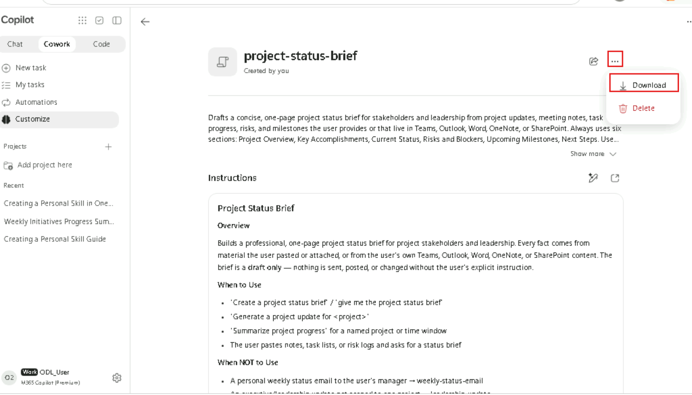

13. Verify the browser's **Downloads** panel shows **project-status-brief.md**.

14. Keep the downloaded file for the upload exercise in the next task.

    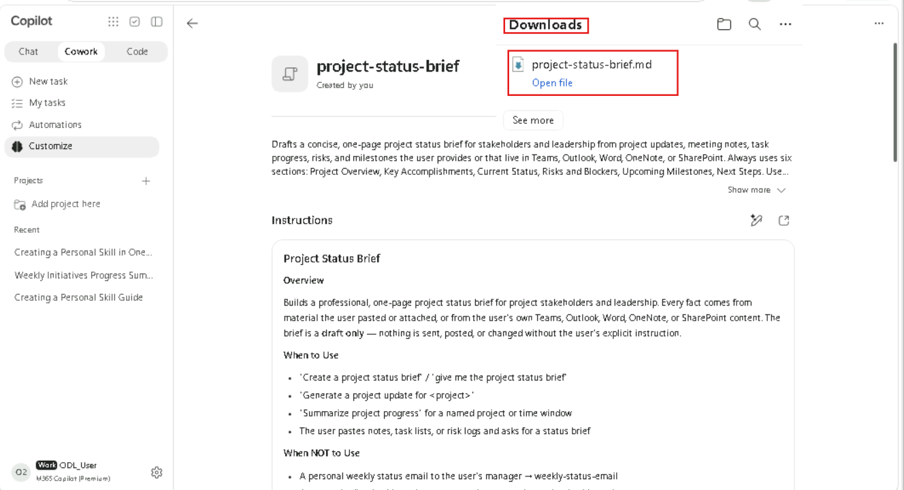

## Task 7: Upload and Run the Project Status Brief Skill

Skills can be shared as files and uploaded again. In this task, you upload the skill file you downloaded, and then run the skill with one of its trigger phrases.

1.  In the left navigation pane, select **Customize**.

2.  Select **Add**, and then select **Upload**.

    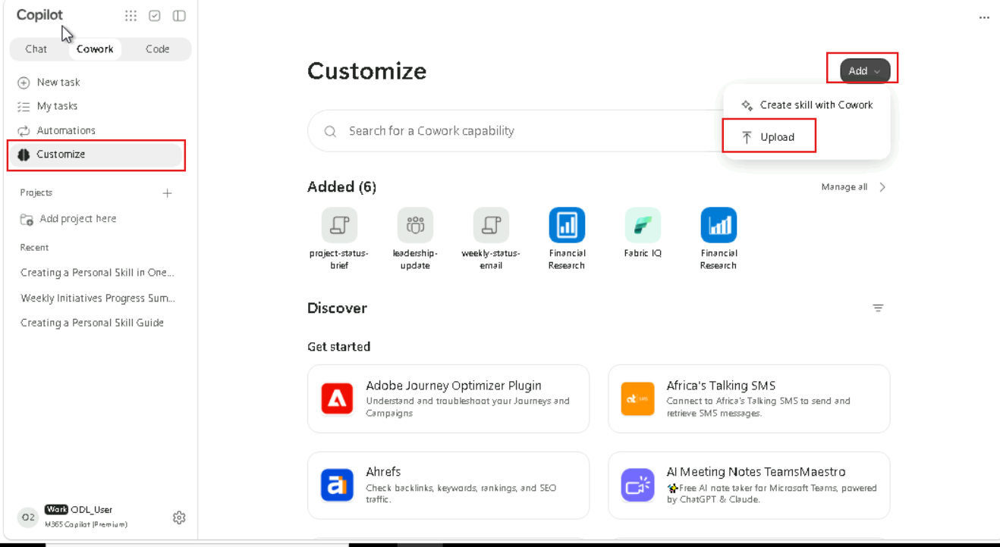

3.  In the **Upload a skill or plugin** dialog, review the supported file types: **.MD**, **.ZIP**, or **.SKILL**.

4.  Select **choose a file**.

    > **Note:** Skills and plugins run as instructions to Cowork and can connect it to external services. Only upload files from sources you trust.

    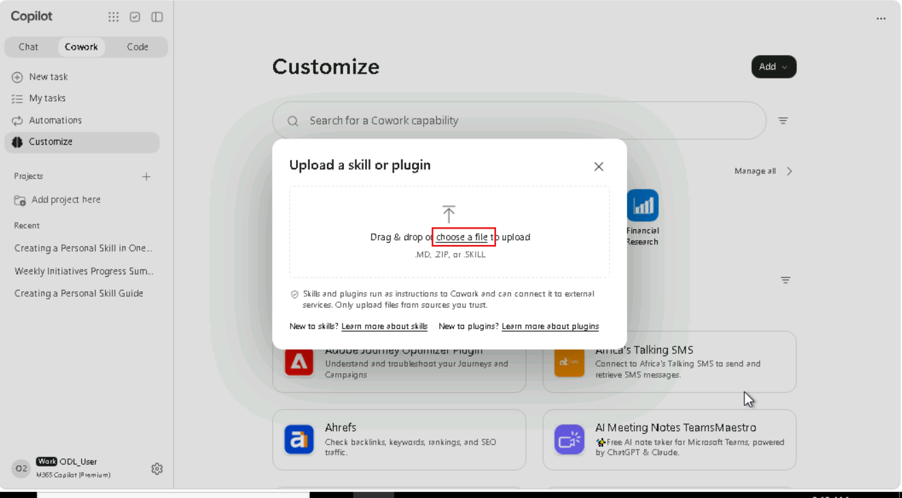

5.  In the **Open** dialog, select **Downloads**.

6.  Select the **project-status-brief** file.

7.  Verify **project-status-brief** appears in the **File name** field, and then select **Open**.

    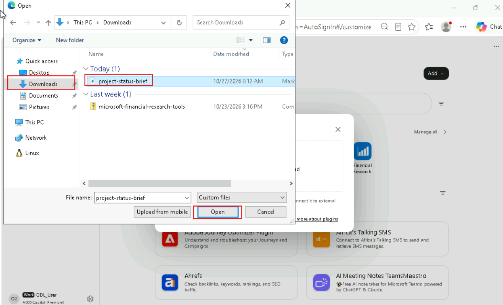

8.  Verify the uploaded skill appears under **Added** as **project-status-brief-1**, next to the original **project-status-brief** skill.

    > **Note:** Because a skill named **project-status-brief** already exists, Cowork adds **-1** to the name of the uploaded copy.

    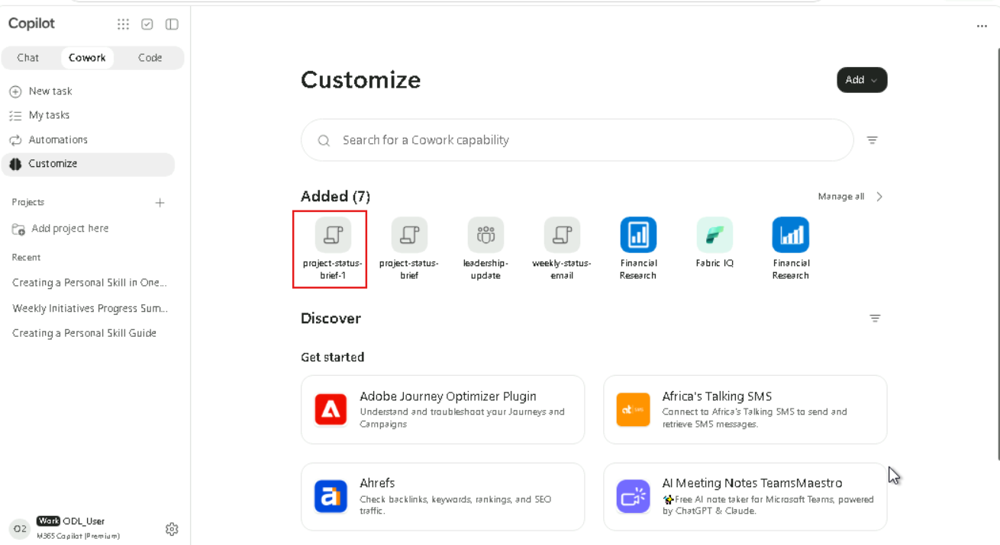

9.  In the left navigation pane, select **New task**.

10. In the prompt box, enter the following trigger phrase:

    ```
    give me the project status brief
    ```

11. Select the **Send** (arrow) button or press **Enter**.

    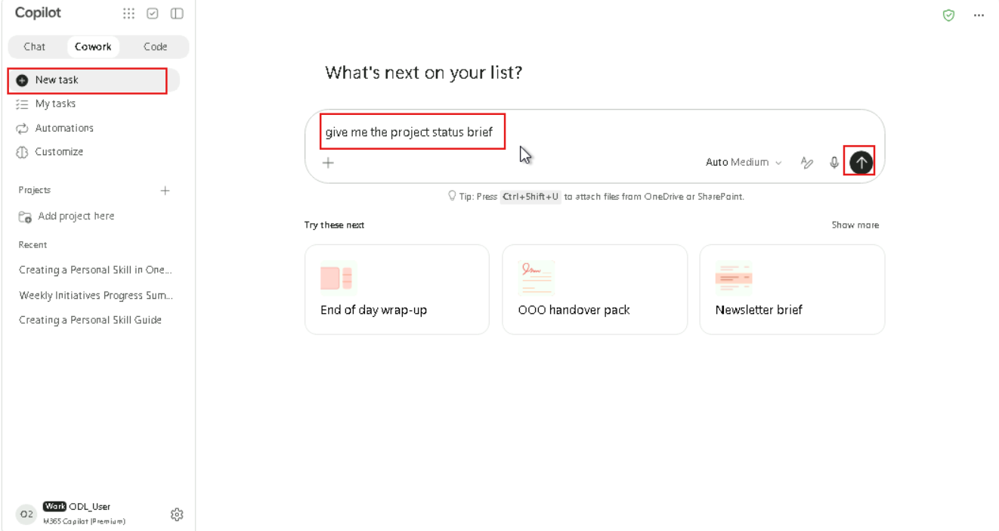

12. Wait for Cowork to process the request. Verify a new task, such as **Project Status Brief Summary**, appears under **Recent** in the left navigation pane.

13. In the **Workspace** pane, verify **project-status-brief** appears under **Plugins**, along with the connectors Cowork used to find project content, such as **SharePoint**.

14. Review the generated brief and verify it includes the reporting period and the six sections: **Project Overview**, **Key Accomplishments**, **Current Status**, **Risks and Blockers**, **Upcoming Milestones**, and **Next Steps**.

    > **Note:** When a detail isn't available in your content, the skill shows **Not stated** instead of making it up.

    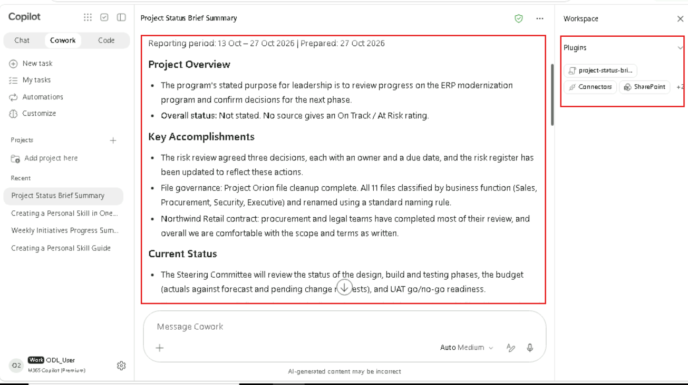

## Task 8: Post the Project Status Brief to a Teams Channel

Skills become most useful when their output goes somewhere useful. In this task, you ask Cowork to post the brief to a Microsoft Teams channel, and you approve the post before it's sent.

1.  In the **Message Cowork** box of the same task, enter the following instruction:

    ```
    send the updates to Teams Retail> General
    ```

2.  Select the **Send** (arrow) button or press **Enter**.

    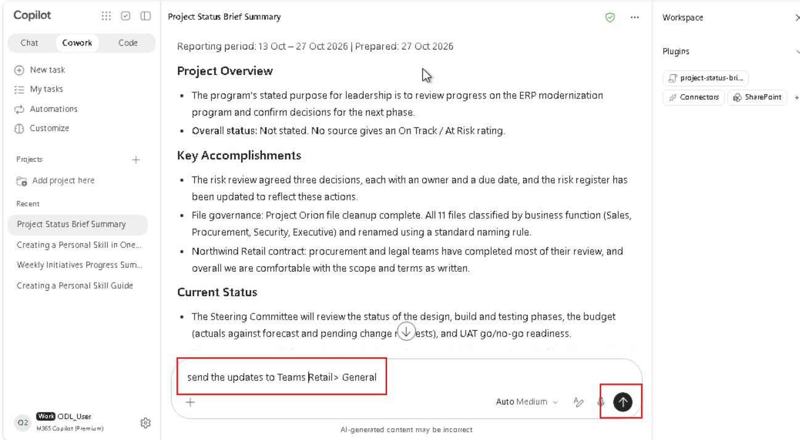

3.  Wait for the **Post to channel?** approval card to appear.

4.  Review the posting details and verify the following:

- **Channel:** \#General

- **Subject:** Project Orion Status Brief, with the reporting period

- **Message preview** with the brief's sections

- **Risk level** shown in the upper-right corner of the card

5.  Select **Send** to approve the Teams post.

    > **Note:** You can edit the subject and message in the card before you send it, or select **Cancel** to stop the post.

    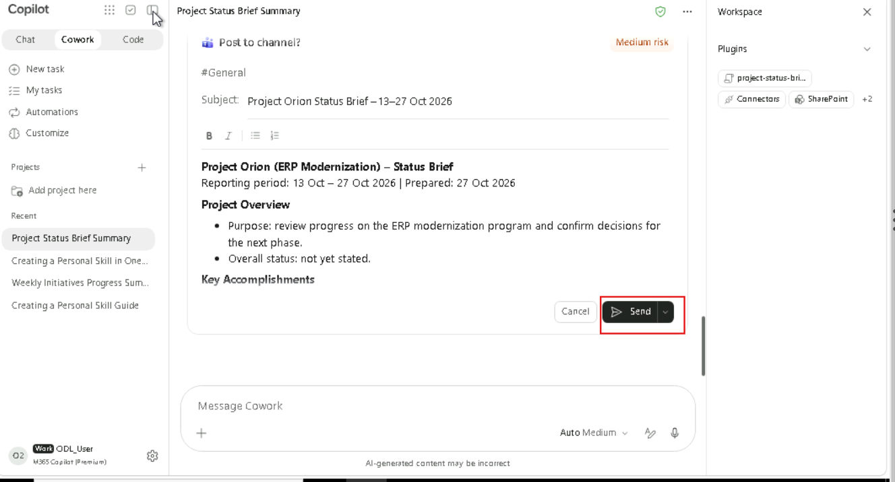

6.  Review the confirmation message and verify that Cowork posted the Project Orion status brief to the **General** channel of the **Retail** team.

7.  Review the notes about what Cowork left out of the post, such as internal notes, and any date conflicts it asks you to check.

8.  Verify the **General** (Posted to Teams) card appears in the response and **General** is listed under **Output** in the Workspace pane.

    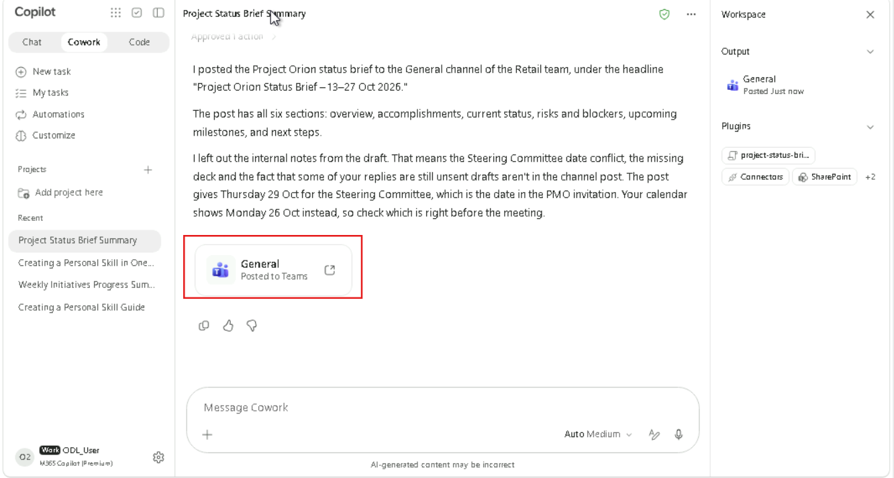

9.  Open Microsoft Teams. You can select the open icon on the **General** card, or go to **https://teams.microsoft.com** in a new browser tab.

10. If you're prompted to download the Teams desktop app, select **Use the web app instead**.

    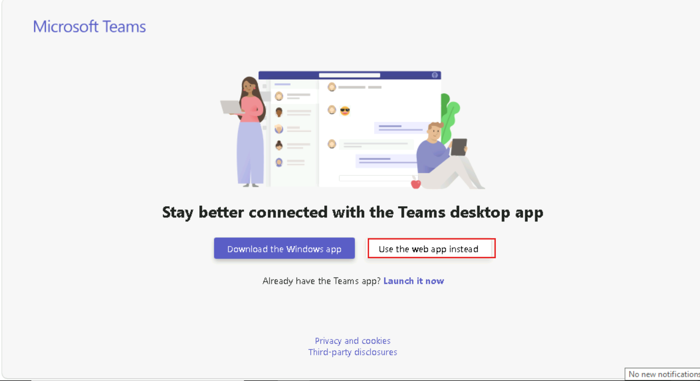

11. In Teams, under **Teams and channels**, select **Retail** \> **General**.

12. Verify the **Project Orion Status Brief** post appears in the channel and includes the following:

- The Project Status Brief title

- The reporting period

- The **Project Overview** and **Key Accomplishments** sections, followed by the rest of the brief

13. Verify the end-to-end workflow completed:

- Project Status Brief generated by the custom skill

- Teams post approved in Cowork

- Message delivered to the **Retail** \> **General** channel

    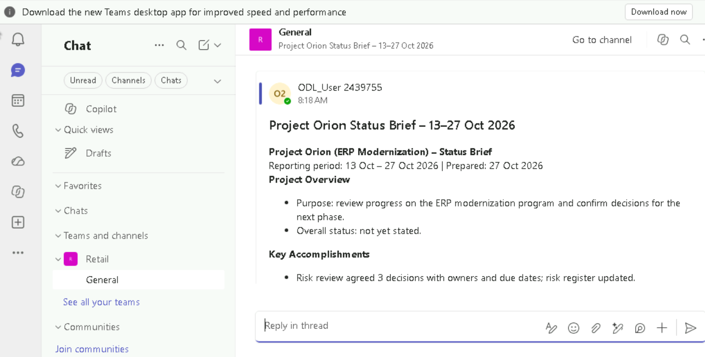

## Review

In this lab, you completed the following:

- Learned what a custom skill is and planned a skill specification on paper — capturing purpose, inputs, outputs, and trigger phrases — before using the builder

- Started the Copilot Cowork skill builder from Customize \> Add \> Create skill with Cowork and built the Leadership Update skill (leadership-update) by answering a short series of questions instead of filling out a form

- Approved the save of the skill to your Cowork skills folder in OneDrive and reviewed the skill quality report

- Tested the Leadership Update skill with a sample input and confirmed it generated a structured update with Headline, Progress, Risks and Blockers, and Asks / Next Steps sections

- Verified the custom skill was listed under Added on the Customize page

- Built a second custom skill, the Project Status Brief (project-status-brief), from a written description, category, name, and rules

- Reviewed the skill's quality report and details page — Overview, When to Use, and When NOT to Use — and its Download and Delete options, then downloaded the skill file

- Uploaded the downloaded skill file and invoked the Project Status Brief skill using its trigger phrase

- Directed Copilot Cowork to post the generated Project Status Brief to a Microsoft Teams channel, reviewing and approving the post before it was sent

### You have successfully completed the Lab!

Now, click on **Next \>\>** from the lower right corner to move on to the next page.

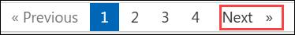
